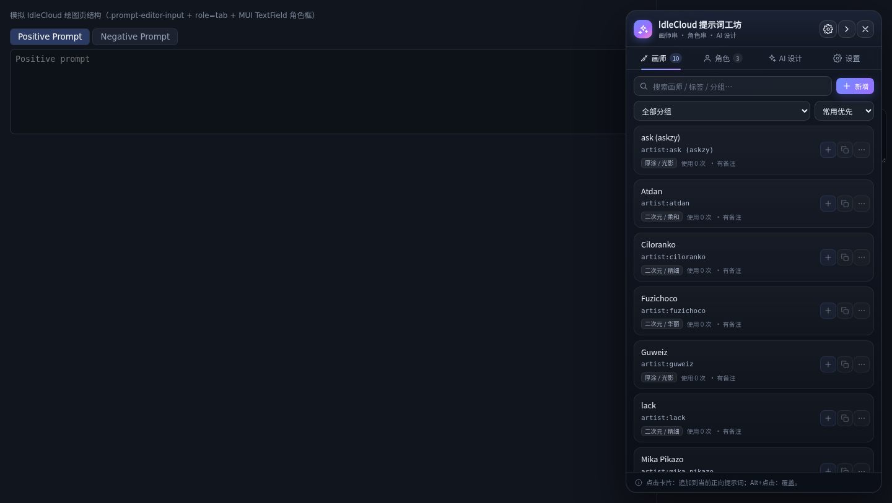
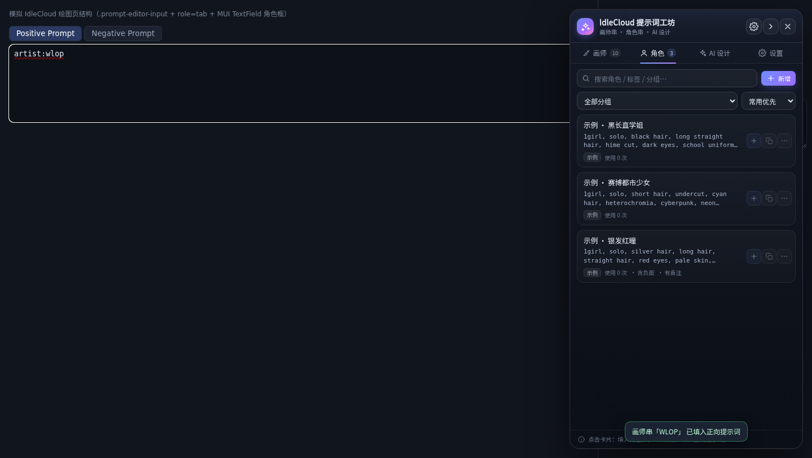
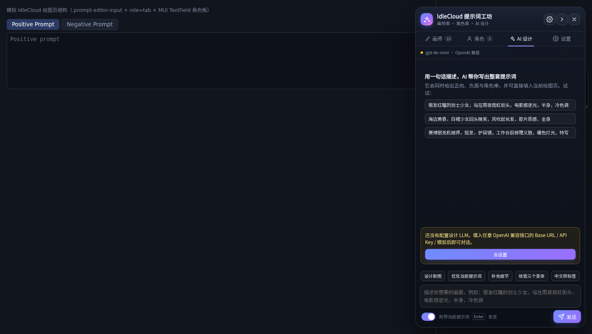
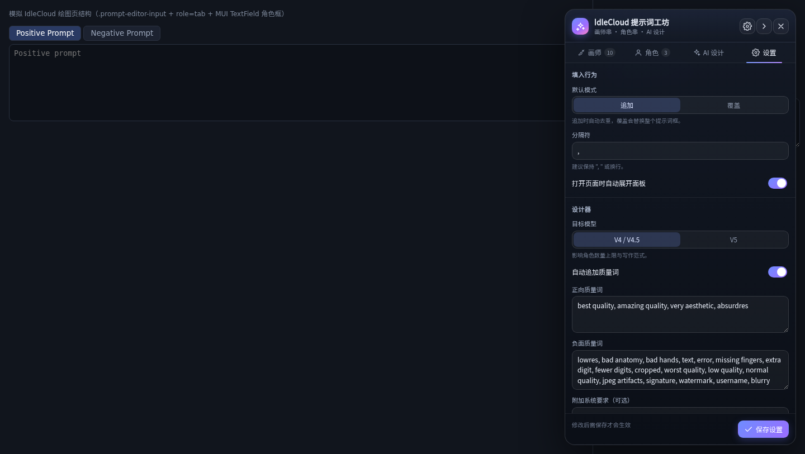
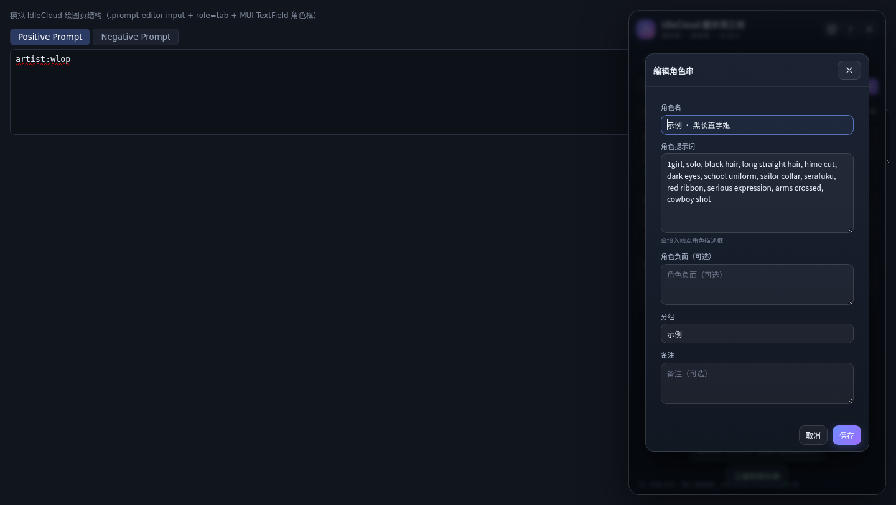
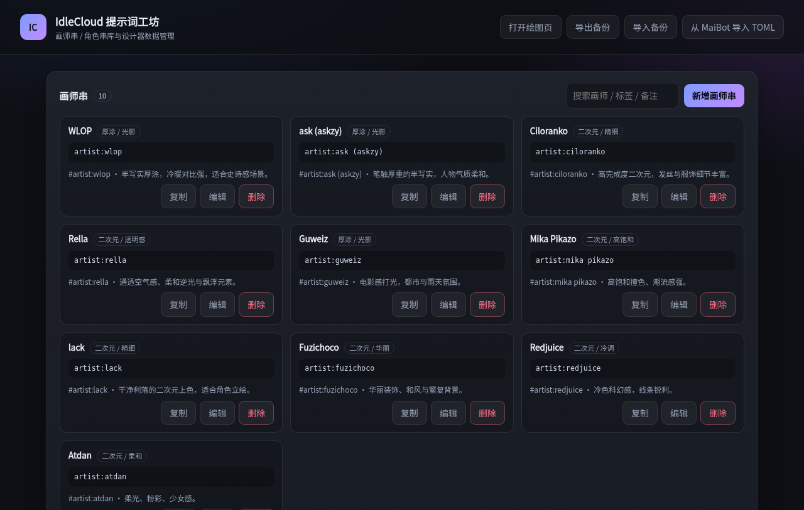

# IdleCloud 提示词工坊（浏览器扩展）

把 [MaiBot NovelAI 绘图插件](https://github.com/Yorko7140/maibot-novelai-drawer) 里那套「画师串 / 角色串 / 提示词设计」能力搬进浏览器，直接挂在 [nai.idlecloud.cc](https://nai.idlecloud.cc/main) 的绘图页上使用。

- 浏览器扩展（Chrome / Edge / 任意 Chromium，Manifest V3）
- 不改动原插件源码，可独立安装、独立发布
- 所有数据存在浏览器本地（`chrome.storage.local`），不上传服务器

## 界面预览

| 画师串库 | 角色串库 |
| --- | --- |
|  |  |

| AI 设计对话 | 设置 |
| --- | --- |
|  |  |



独立的数据管理工作台（`chrome://extensions` → 扩展详情 → 扩展程序选项）：



## 功能

### 1. 画师串库

- 保存画师串：名称、标签串（如 `artist:wlop`）、分组、备注、收藏
- 一键填入正向提示词框；`Alt + 点击` 覆盖填入；卡片菜单可填到负面提示词
- 追加模式自动去重（同一画师串不会重复写进提示词）
- 搜索、按分组筛选、按使用次数/名称排序
- 内置 10 个常用画师种子（WLOP、ciloranko、kedama_milk 等）

### 2. 角色串库

- 保存角色串：正向描述、负面/Avoid、分组、备注
- 点击角色卡 → 填入站点「角色描述框」；`Alt + 点击` → 填到正向提示词
- 角色框不存在时自动展开角色面板或点「Add Character」新增一个
- 支持把角色负面串写进角色 Avoid 页签

### 3. AI 提示词设计（自然语言对话）

- 侧边栏直接聊：「银发红瞳的剑士少女，雨夜霓虹街头，电影感」→ 返回结构化方案
- 方案卡包含：标题、正向提示词、负面提示词、角色列表、设计说明
- 「填入全部」一次性写进正向提示词 + 角色框，并按设置自动追加质量词
- 快捷指令：全新设计 / 增强细节 / 细化描述 / 出变体 / 中英对照
- 自动读取当前页面已有的提示词作为上下文，可在已有基础上改
- 适配目标模型：V4 / V4.5（Danbooru 标签风格，最多 6 角色）与 V5（自然语言风格，最多 12 角色）
- LLM 走扩展 background 统一代理：支持 OpenAI 兼容接口（OpenAI、DeepSeek、OpenRouter、硅基流动…）、Anthropic Messages、自定义 Base URL；支持 SSE 流式输出、随时中止、失败重试

### 4. 数据迁移与备份

- 「从 MaiBot 导入 TOML」：直接选原插件的 `character_cards.toml` 和 `generation_profiles.toml`
  - 角色卡 → 角色串（`prompt` + `default_outfit` 合并为正向，`negative` → Avoid）
  - `[primary.styles]` / `[fallback.styles]` 里的画风串 → 画师串（含 `0.3::…::` 权重语法原样保留）
  - 按名称去重，可反复导入
- JSON 导出 / 导入备份，扩展内工作台与侧边栏都能操作

## 安装

1. 打开 `chrome://extensions`（Edge 是 `edge://extensions`）
2. 打开右上角「开发者模式」
3. 点「加载已解压的扩展程序」，选择本目录（含 `manifest.json` 的那一层）
4. 打开 <https://nai.idlecloud.cc/main>，登录后右下角会出现悬浮球；检测到绘图页会自动展开面板

快捷键 `Alt + Shift + N` 或点击扩展图标可随时开合面板。

## 使用

- **画师标签页**：点卡片即追加到正向提示词；卡片右上角按钮可复制、编辑、删除、收藏、填入负面
- **角色标签页**：点卡片即填角色框；`Alt + 点击` 填正向提示词
- **AI 设计标签页**：先在「设置」里填 LLM 的 Base URL / API Key / 模型，再对话
- **设置标签页**：填入模式（追加/覆盖）、分隔符、目标模型、质量词、LLM、数据管理
- **检测绘图页结构**（设置页底部）：站点改版导致填不进去时，先点这个按钮，把输出的 JSON 贴给开发者即可快速适配

### LLM 配置示例

| 服务 | Base URL | 模型示例 |
| --- | --- | --- |
| OpenAI | `https://api.openai.com/v1` | `gpt-4o-mini` |
| DeepSeek | `https://api.deepseek.com/v1` | `deepseek-chat` |
| OpenRouter | `https://openrouter.ai/api/v1` | `google/gemini-2.0-flash-001` |
| 硅基流动 | `https://api.siliconflow.cn/v1` | `Qwen/Qwen2.5-72B-Instruct` |
| Anthropic | `https://api.anthropic.com/v1` | `claude-3-5-sonnet-latest` |
| 自建 / 中转 | 你的地址（自动补 `/chat/completions`） | 服务商模型名 |

Base URL 只需要填到 `/v1` 这一层，扩展会自动补全接口路径。

> **关于跨域授权**：扩展默认只申请 `nai.idlecloud.cc` 的权限。LLM 接口是第三方域名，
> 首次使用前请到「扩展选项」页（`chrome://extensions` → 扩展详情 → 扩展程序选项）
> 在「域名授权」处点一次 **授权访问该域名**，或直接点「保存设置」时按提示授权。
> 这样扩展才能代你请求该 API；未授权时请求会被浏览器以 CORS 拦截。

## 目录结构

```
manifest.json                 MV3 清单
src/background.js             LLM 代理（流式 SSE / 非流式、协议适配）
src/shared/store.js           数据层（chrome.storage + localStorage 回退）
src/shared/toml.js            MaiBot TOML 解析与导入
src/content/main.js           注入入口、路由监听
src/content/adapter.js        与站点 DOM 的适配层（选择器 + 兜底 + 诊断）
src/content/promptlib.js      设计器 system prompt、消息组装、JSON 解析
src/content/panel.js          侧边栏 UI（Shadow DOM）
src/content/panel-ai.js       AI 设计页、设置页、数据管理
src/content/ui.js             轻量 DOM 原语
src/options/                  数据管理工作台（options 页）
tests/                        端到端测试（真实 Chromium + mock LLM）
```

### 与站点的对接方式

站点的提示词编辑器结构（从线上 bundle 反推）：

- 编辑器容器：`.prompt-editor-input`，内层 `textarea`
- 正向 / 负向是同一个面板的两个 MUI Tab（`[role="tab"]`，索引 0 = 正向，1 = 负向）
- 角色描述：参数区每个角色一个 MUI `TextField`（multiline），紧邻「Add Character」按钮

`adapter.js` 按结构选择器定位，不依赖界面文案；同时保留三级兜底：

1. 标准结构（`.prompt-editor-input` + Tab）
2. 结构漂移 → 向上找包含 Tab 的容器
3. 完全找不到 → 填到「最后一次聚焦的输入框」（先在站点输入框点一下，再点填卡即可）

## 开发与测试

```bash
# 端到端测试：真实 Chromium 加载扩展 + 模拟绘图页 + mock LLM
node tests/run.mjs

# 只验证真实站点注入（不需要登录）
node tests/real-site.mjs
```

测试共 20 项，覆盖：content script 注入、绘图页自动展开、种子库、画师填充、去重、
角色框填充、设置页保存与默认质量词、AI 对话（真实走 background → mock SSE）、方案「填入全部」、
异形结构兜底、MaiBot TOML 导入、管理工作台渲染、无未捕获异常。

依赖：Node ≥ 20（用到内置 `WebSocket`、`fetch`）、本机 Chromium（默认取 Playwright 缓存里的 chromium，可用 `CHROME_PATH` 覆盖）。

## 已知限制

- 站点的 `/main` 需要登录，开发阶段无法直接读取登录后的真实 DOM；对接层基于线上 bundle 的组件结构推断，并做了多级兜底。如果填入失败，请用「检测绘图页结构」导出诊断信息。
- 站点把文案打包进 JS chunk，没有稳定的 i18n JSON，所以本扩展只在「添加角色」按钮这类必须靠文案识别的场景使用多语言正则。
- LLM 的 Key 存在浏览器本地（`chrome.storage.local`），仅用于你自己配置的服务；扩展本身不收集任何数据。

## 路线图

- [ ] 提示词片段库（构图 / 光影 / 表情 / 服装）
- [ ] 画师串组合器（多选后按权重合并成一条）
- [ ] 从站点当前提示词「反向保存」为画师串 / 角色串
- [ ] 多家 LLM 主备切换与失败自动重试
- [ ] 站点 DOM 改动后的自动诊断上报

## 许可

与原插件保持一致，见上游仓库。
